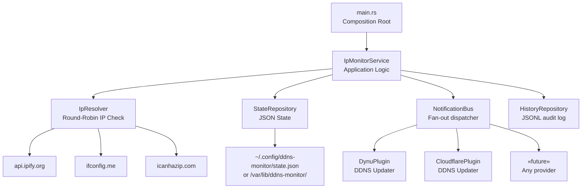
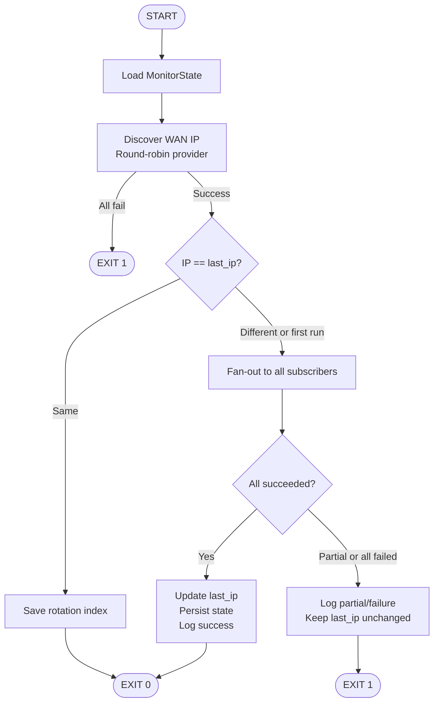

# ddns-monitor — Project ROADMAP

> [!NOTE]
> This document supersedes the `dynu-monitor` README. The project is being renamed and
> broadened from a single-provider Dynu wrapper into a generic, provider-agnostic DDNS
> monitor with a plugin architecture.

---

## What Already Exists

| File | What it does |
|---|---|
| [`nixos/scripts/monitor.py`](file:///home/kiskaadee/Homelab/Core/nixos/scripts/monitor.py) | Python prototype — round-robins IP providers, compares to history, fires `ddclient` |
| [`nixos/modules/dynu.nix`](file:///home/kiskaadee/Homelab/Core/nixos/modules/dynu.nix) | NixOS module wiring monitor.py + ddclient + sops secrets via systemd oneshot timer |
| [`src/main.rs`](file:///home/kiskaadee/Projects/active/ddns-monitor/src/main.rs) | Rust scaffold — placeholder `main()` |
| [`src/models.rs`](file:///home/kiskaadee/Projects/active/ddns-monitor/src/models.rs) | Draft structs: `MonitorState`, `IpDiscoveryResult` (syntax error present) |
| `README.md` | Architecture blueprint for a single-provider Rust rewrite (good bones, narrower scope) |

**Root cause of today's outage:** Dynu API went down (data corruption incident). The monitor
currently couples the IP-check layer *and* the update-submission layer to a single provider
ecosystem. If Dynu is unreachable, the entire update chain breaks regardless of what the IP
checkers report.

---

## Motivation for the Redesign

The Python script already solves the **IP-detection** problem well. What it lacks is:

1. **Provider independence for updates** — it delegates to `ddclient`, which is Dynu-specific.
2. **Fan-out** — one IP change must notify *all* configured domains, possibly across different
   DDNS providers or multiple accounts on the same provider.
3. **Resilience** — if one DDNS provider is down, others should still be notified.
4. **NixOS portability + non-FSH Linux support** — the binary should be usable on both.
5. **No runtime Python dep** — a statically linked Rust binary compiles cleanly into a
   Nix derivation and works on non-NixOS systems without a Python interpreter.

---

## Target Architecture



### Separation of Concerns

| Layer | Responsibility | Knows about |
|---|---|---|
| **IpMonitorService** | Orchestration & decisions | Traits only |
| **IpResolver** | WAN IP discovery + rotation | HTTP |
| **StateRepository** | Persisted last-known-good IP | JSON / fs |
| **NotificationBus** | Fan-out to all subscribers | Vec of `DdnsUpdater` |
| **DdnsUpdater trait** | Contract for one provider plugin | Nothing external |
| **DynuUpdater** | Dynu HTTP API v2 | reqwest |
| **CloudflareUpdater** | Cloudflare DNS API | reqwest |
| **HistoryRepository** | Append-only audit trail | JSONL / fs |

---

## Core Entities

### MonitorState
```text
MonitorState
├── last_provider_index: Option<usize>   -- which IP-check provider goes next
└── last_ip: Option<Ipv4Addr>           -- IP from last *fully successful* update round
```
`last_ip` advances only when **every** subscriber in the notification bus reports success.

---

### DdnsUpdater (trait — the plugin contract)
```text
DdnsUpdater
├── name() -> &str
└── update(ip: Ipv4Addr) -> Result<(), UpdateError>
```
All provider-specific HTTP, auth, and retry logic lives behind this trait.

---

### SubscriberConfig (from config file or NixOS options)
```text
SubscriberConfig
├── provider: String       -- "dynu" | "cloudflare" | ...
├── domain: String
└── credentials: ...       -- per-provider fields
```

---

### IpDiscoveryResult
```text
IpDiscoveryResult
├── ip: Ipv4Addr
├── provider: String       -- which checker responded
└── provider_index: usize  -- for rotation persistence
```

---

### HistoryEntry
```text
HistoryEntry
├── timestamp: DateTime<Utc>
├── ip: Ipv4Addr
├── subscribers: Vec<SubscriberResult>  -- one record per provider
└── overall_status: "success" | "partial" | "failed"
```

---

## Update Semantics

> [!IMPORTANT]
> **Partial success rule:** if 3 of 4 subscribers succeed and 1 fails, `last_ip` is **not**
> updated. The next cycle will retry all subscribers. This is conservative: a transient
> failure on one subscriber won't cause the other three to re-update unnecessarily on
> subsequent cycles because `last_ip` hasn't advanced.
>
> This is a deliberate trade-off. An alternative (advance `last_ip` per-subscriber) is more
> complex and deferred to a future enhancement.

---

## Core Workflow



---

## Configuration

The service should accept configuration from two sources, in priority order:

1. **NixOS module options** (declarative, build-time)
2. **`~/.config/ddns-monitor/config.toml`** (runtime, for non-NixOS)

```toml
# Example config.toml
[ip_providers]
urls = [
    "https://api.ipify.org",
    "https://ifconfig.me/ip",
    "https://icanhazip.com",
]
timeout_secs = 5

[[subscribers]]
provider = "dynu"
domain = "roadtotech.me"
credentials_env = "DYNU_PASSWORD"   # or path to a secrets file

[[subscribers]]
provider = "dynu"
domain = "backupserver.me"
credentials_env = "DYNU_PASSWORD_2"

# future
# [[subscribers]]
# provider = "cloudflare"
# domain = "example.com"
# zone_id = "..."
```

> [!NOTE]
> Credentials should never be stored in the config file in plaintext. On NixOS, sops-nix
> provides secrets via environment or file. On non-NixOS, the binary accepts env var names
> or secret-file paths.

---

## NixOS Integration Target

Replace `dynu.nix` with a new module that:

- Builds `ddns-monitor` as a Nix derivation (native Rust build)
- Exposes `services.ddns-monitor.subscribers` as a list of NixOS option sets
- Injects credentials from `sops.secrets` via systemd `LoadCredential`
- Runs as a oneshot systemd timer (same 30-minute cadence, configurable)
- **Does not depend on `ddclient`** — the binary calls provider APIs directly

---

## Implementation Phases

### Phase 0 — Cleanup & Rename *(Now)*
- [ ] Fix syntax error in `models.rs`
- [ ] Rename crate from `dynu-monitor` to `ddns-monitor` in `Cargo.toml`
- [ ] Add `Cargo.toml` dependencies: `serde`, `serde_json`, `toml`, `reqwest` (blocking), `thiserror`
- [ ] Stub out module tree: `domain/`, `infra/`, `config.rs`, `plugins/`

---

### Phase 1 — Domain Layer
*No external dependencies. Pure Rust types and logic.*

- [ ] `MonitorState` with correct types (`Option<Ipv4Addr>`, `Option<usize>`)
- [ ] `IpDiscoveryResult`
- [ ] `HistoryEntry` + `SubscriberResult`
- [ ] IPv4 public-address validation (port Python's RFC-aware logic)
- [ ] Provider rotation logic (next index from state)
- [ ] `DdnsUpdater` trait
- [ ] `UpdateError` enum with `thiserror`
- [ ] Unit tests: rotation, validation, state transitions

**Learning targets:** structs, enums, `Option<T>`, traits, `Result<T, E>`, unit tests

---

### Phase 2 — Configuration
*Parse config file and build subscriber list.*

- [ ] `Config` struct with `serde` + `toml`
- [ ] `SubscriberConfig` with per-provider credential resolution (env var → file → error)
- [ ] NixOS module integration stubs (paths, env vars, state dir)
- [ ] Unit tests: config parsing, credential resolution errors

**Learning targets:** `serde`, generics, `Result` propagation with `?`

---

### Phase 3 — Application Service
*Wire domain + config into orchestration logic.*

- [ ] `IpMonitorService` struct taking trait objects
- [ ] Full workflow (load → discover → compare → fan-out → persist → log)
- [ ] In-memory fake implementations for all trait dependencies
- [ ] Integration-style unit tests: no HTTP, no fs, no systemd

**Learning targets:** dependency injection via traits, `Box<dyn Trait>`, borrowing, lifetime basics

---

### Phase 4 — IP Resolution (HTTP)
*Real network calls.*

- [ ] `HttpIpResolver` using blocking `reqwest`
- [ ] Timeout configuration
- [ ] Provider fallback loop
- [ ] Address validation on response
- [ ] Unit tests: mock server or `mockito`

**Learning targets:** HTTP clients, blocking async in Rust, error propagation

---

### Phase 5 — State & History (Filesystem)
*Persistent JSON state and JSONL audit log.*

- [ ] `JsonStateRepository`: atomic write (write-to-tmp → rename)
- [ ] `JsonlHistoryRepository`: append-only writes
- [ ] State directory creation (respects `StateDirectory=` systemd or XDG on non-NixOS)
- [ ] Unit tests: serialization round-trips, atomic write behavior

**Learning targets:** file I/O, `serde_json`, atomic FS patterns

---

### Phase 6 — Dynu Plugin
*First real DDNS provider.*

- [ ] `DynuUpdater` implementing `DdnsUpdater`
- [ ] Calls Dynu HTTP API v2 directly (no ddclient)
- [ ] Credential loading from env / sops file
- [ ] Parses Dynu API response to confirm success
- [ ] Unit tests with mocked HTTP

> [!NOTE]
> The Python script currently goes through `ddclient`. This phase eliminates that dependency.
> The Dynu API is simple: a single HTTPS GET with credentials and the new IP in query params.

---

### Phase 7 — Fan-out & NotificationBus
*Multiple subscribers.*

- [ ] `NotificationBus` iterating all configured `DdnsUpdater`s
- [ ] Collects per-subscriber results
- [ ] Applies partial-success rule (all-or-nothing `last_ip` advance)
- [ ] Integration test: 1 success + 1 failure → state unchanged

---

### Phase 8 — NixOS Module Rewrite
*Replace dynu.nix.*

- [ ] New `ddns-monitor.nix` module with subscriber list options
- [ ] Rust binary as Nix derivation (via `rustPlatform.buildRustPackage`)
- [ ] Credential injection via `LoadCredential` + sops-nix
- [ ] Timer configuration (interval, boot delay)
- [ ] Smoke test on homelab server

---

### Phase 9 — Non-NixOS Support *(stretch)*
*Make it usable on Debian/Arch/etc.*

- [ ] XDG config dir fallback (`~/.config/ddns-monitor/`)
- [ ] State dir fallback (`~/.local/share/ddns-monitor/` or `/var/lib/ddns-monitor/`)
- [ ] `systemd.service` unit file (generic, for non-NixOS install)
- [ ] Install instructions for manual systemd setup

---

### Phase 10 — Additional Providers *(stretch)*

- [ ] `CloudflareUpdater`
- [ ] `DuckDNSUpdater`
- [ ] Provider auto-detection from config `provider =` field
- [ ] Consider: compile-time feature flags per provider

---

## What This Project Is NOT (in scope now)

- No GUI or web API
- No IPv6 (explicitly deferred)
- No async networking (blocking reqwest is fine for a oneshot binary)
- No hot config reloading
- No concurrent provider queries
- No database
- No authentication layer on the binary itself

---

## Definition of Done (Phase 6 complete = "v1 usable")

- [ ] Binary discovers WAN IP via rotating providers
- [ ] Persists state across executions
- [ ] Detects IP changes correctly
- [ ] Calls Dynu API directly (no ddclient dependency)
- [ ] Notifies all configured subscribers on change
- [ ] Leaves `last_ip` unchanged on any subscriber failure
- [ ] Core logic is fully covered by unit tests (no real HTTP / fs / network)
- [ ] NixOS module replaces `dynu.nix` and `monitor.py`
- [ ] Tested live on homelab server

---

## Open Questions

1. **Partial success policy** — should `last_ip` advance per-subscriber (more complex, avoids
   duplicate updates on retry) or stay all-or-nothing (simpler, may cause harmless re-updates)?
   Current plan: all-or-nothing. Revisit after Phase 7.

2. **Binary distribution** — Nix derivation is the primary path. Should a static musl build
   also be published for non-NixOS users?

3. **Credential model** — env var → file → error is the current plan. Should we also support
   a `pass` / `age`-encrypted file directly?
